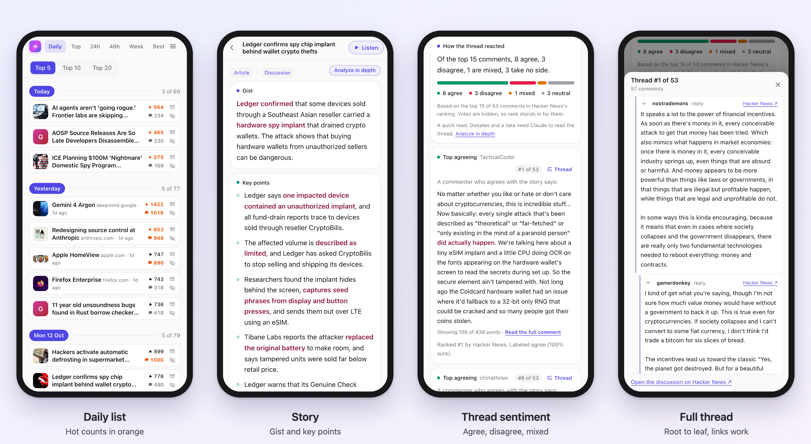
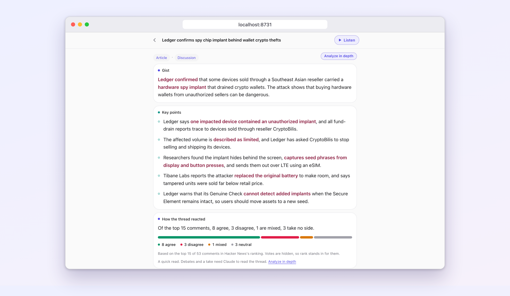
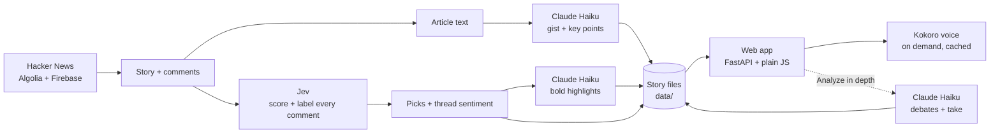
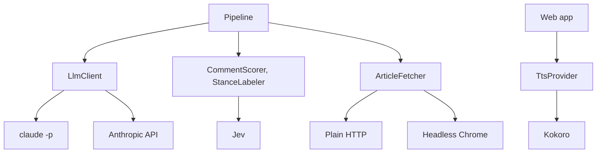

# Hackernews Lite

**Hacker News, read for you.** Summarizes each article, picks the comments worth reading, measures whether the thread agrees or pushes back, and reads it all aloud. Runs on your own machine.

[](LICENSE)


<p align="center">
  
</p>

<p align="center">
  
  <br><sub>Built for a phone, and works in any desktop browser too.</sub>
</p>

## Features

- **Article summaries.** A short gist and key points, written for listening.
- **Comment analysis.** HN hides vote counts but sorts comments by them, so the app starts from the top of HN's own ranking, scores those comments for first-hand experience, corrections and substance, and picks the best. Each card shows its HN rank, like "#1 of 53".
- **Thread sentiment.** The top 15 comments in HN's ranking are labeled agree, disagree, mixed or neutral, with the strongest voice on each side.
- **Analyze in depth.** On request, Claude maps the main debates and gives its own take.
- **Full threads.** Tap any comment to open its whole conversation, root to leaf, with working links.
- **Listen.** A local voice (Kokoro) reads each card. Free, offline, cached after the first play.
- **Daily lists.** The best 5, 10 or 20 stories of each day, plus Top, 24h, 48h, Week and Best.
- **Hot stories.** Upvote and comment counts turn orange when a story is climbing fast or very busy.
- **Cheap.** About 8,000 Claude tokens and $0.002 of Jev per story, ready in about 15 seconds.
- **Phone or desktop.** Made for a phone-sized screen, and works in any browser. Use `--lan` to open it from your phone.
- **Private.** No account, no hosting. Everything stays on your machine.

## Get started

You need [uv](https://docs.astral.sh/uv/), Python 3.12+ and [Claude Code](https://claude.com/claude-code), logged in.

```bash
git clone https://github.com/codowolf/hackernews-lite.git
cd hackernews-lite
uv sync
cp .env.example .env        # optional: add TYPESAFE_API_KEY (see below)
uv run hackernews-lite serve
```

Open <http://localhost:8731>. The first play downloads the voice model (about 340 MB, once).

**Using Claude Code?** Paste this:

> Clone https://github.com/codowolf/hackernews-lite, follow "Get started" in its README, start the app, and give me the URL. If I have a TypeSafe key, ask me for it and save it as TYPESAFE_API_KEY in .env. Never print the key.

| Optional | What it adds |
|---|---|
| `TYPESAFE_API_KEY` in `.env` | Comment picks and thread sentiment. Without it you get summaries and the top comments in HN order. |
| Google Chrome | Retries articles from sites that block plain downloads. |
| `serve --lan` | Open it from your phone on the same wifi. There is no login, so use a network you trust. |
| `provider = "anthropic"` in `config.toml` | Pay per call with `ANTHROPIC_API_KEY` instead of using your Claude subscription. |

## Architecture



Each stage saves its output with a hash of its input, so nothing is paid for twice. Vendors sit behind small interfaces, so swapping one means adding a class:



**Why two models.** Claude writes; Jev reads.

| Job | Model | Why |
|---|---|---|
| Gist, key points, highlights, in-depth take | Claude Haiku, through `claude -p` on your subscription (or the API) | Good prose |
| Scoring every comment, agree/disagree labels | [Jev](https://docs.typesafe.ai) by TypeSafe | Typed yes/no questions with probabilities. Fast and about $0.002 per story, so Claude never reads the thread. |

| Path | What it is |
|---|---|
| `src/hackernews_lite/domain/` | Pure models and rules. No I/O. |
| `src/hackernews_lite/sources/` | Hacker News, article fetching, preview images |
| `src/hackernews_lite/prep/` | The stages: article, picks, sentiment, highlights |
| `src/hackernews_lite/llm/`, `scoring/`, `speech/` | The Claude, Jev and voice seams |
| `src/hackernews_lite/web/` | FastAPI app, job queue, front end (`static/`, no build step) |
| `prompts/`, `config.toml` | Editable prompts and every setting |

## Token use

Measured on 14 October 2026: 12 stories from the Daily list, then 5 analyzed in depth. Claude Haiku 5.5 at low effort, Jev `jev-latest`.

| Per story | Tokens in | Tokens out | Notes |
|---|---|---|---|
| Gist and key points (Claude) | 5,100 | 400 | Medians |
| Highlights (Claude) | 2,900 | 700 | Sees only the picked quotes |
| **Claude total** | **about 8,000** | **about 1,100** | |
| Scoring and labels (Jev) | 47,000 | none | **$0.002**, 15 seconds in all |
| Analyze in depth (Claude, on request) | about 8,200 | about 7,000 | 24 to 39 seconds |

| Reading | Claude in | Claude out | Jev | Claude at API prices |
|---|---|---|---|---|
| 150 stories a month (5 a day) | 1.2M | 165K | $0.30 | $0.20 |
| 900 stories a month (30 a day) | 7.2M | 1M | $1.80 | $1.20 |

- **Subscription (default).** Claude calls cost nothing per call and count against your plan's usage. Only Jev counts toward the `[budget]` cap. I did not measure your plan's share.
- **What raises cost.** Longer articles. Comment count does not affect Claude, which never reads the thread unless you ask for the in-depth analysis.
- **Caveat.** One startup call used 55,000 input tokens (once in 27 Claude calls, cause unconfirmed). With `claude -p`, input includes cached context Claude Code adds.
- **Use less.** `list_top = 0` under `[prepare]` stops preparing stories you did not open. `on_open = false` stops opening from starting an analysis.
- **Your own numbers.** `data/cost_log.jsonl`, or `uv run hackernews-lite cost`.

## Hot stories

An upvote count turns orange at **30 or more upvotes per hour** since posting. A comment count turns orange at **500 or more comments**. Stories under 100 upvotes never do. The bars are fixed, not relative to the day, and are set under `[trending]` in `config.toml`. The rule is in `domain/trending.py`.

## Commands

| Command | Does |
|---|---|
| `uv run hackernews-lite serve` | Start the app (`--port`, `--lan`) |
| `uv run hackernews-lite run --top 5` | Fetch and prepare a list without the app (`--feed`, `--story`, `--no-llm`) |
| `uv run hackernews-lite show 12345` | Print what was prepared for a story |
| `uv run hackernews-lite cost` | This month's paid spend |
| `uv run pytest`, `ruff check .`, `mypy` | Tests, lint, types |

## Not supported yet

Paywalled pages, PDFs, video and social posts, and GitHub repos (comments only for these).

## Credits

[Kokoro](https://github.com/thewh1teagle/kokoro-onnx) for the voice, [Algolia HN Search](https://hn.algolia.com/api) and the Hacker News API for stories, and [trafilatura](https://trafilatura.readthedocs.io) for article text.

## License

[MIT](LICENSE)
